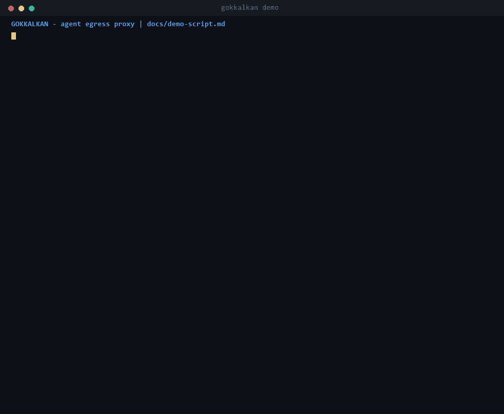

<div align="center">

# GÖKKALKAN

**Ajan Tabanlı Yapay Zekâ Çalışma Zamanı Güvenliği — MCP Egress Proxy & Ajan Honeypot (Göktürk Platform P2)**

[](https://go.dev/)
[](https://www.postgresql.org/)
[](docs/THREAT_MODEL.md)
[](docs/THREAT_MODEL.md)
[](PROJECT_PLAN.md)
[](https://github.com/GokturkFK)

*Zehirli bir araç açıklaması (tool poisoning) veya prompt injection ile yetkisiz bir uca bağlanmaya çalışan yapay zekâ ajanlarını çalışma zamanında kesin; Critical SOC alarmı ve kriptografik imzalı işlem makbuzu üretin — meşru çağrılar hiçbir engelle karşılaşmadan geçsin.*

**🇹🇷 Türkçe** · [🇬🇧 English](#-english)

</div>

---

## Demo



*`docker compose` ile ayağa kaldırılmış canlı yığın (PostgreSQL + `gokkalkan`) üzerinde [`docs/demo-script.md`](docs/demo-script.md) adımları koşularak kaydedilmiştir. Meşru çağrı `api.github.com` adresine ulaşıp `200 OK` döner; yetkisiz/zehirli çağrı kesilir ve imzalı makbuzla birlikte Critical alarm üretir.*

---

## Genel Bakış

**GÖKKALKAN**, Göktürk Güvenlik Platformu'nun 2. sütunudur (P2). **Model Context Protocol (MCP)** ve otonom yapay zekâ ajan çalışma ortamlarını tool-poisoning, prompt injection ve yetkisiz dış çıkış (egress) saldırılarına karşı korur.

[`gokturk-core`](https://github.com/GokturkFK/gokturk-core) paketini doğrudan import eder — [`gokturk-deception-mesh`](https://github.com/GokturkFK/gokturk-deception-mesh) ve [`gokzincir`](https://github.com/GokturkFK/gokzincir) ile birebir aynı `trap.Provider`/`TripEvent` sözleşmesini ve sıfır-FP `correlate.Evaluate` motorunu kullanır.

- Tehdit modeli ve NSA MCP / OWASP Agentic Top 10 eşlemesi: [`docs/THREAT_MODEL.md`](docs/THREAT_MODEL.md)
- Teknik kararlar: [`docs/DECISIONS.md`](docs/DECISIONS.md)
- Proje planı: [`PROJECT_PLAN.md`](PROJECT_PLAN.md)

---

## Çekirdek Paketler

| Paket | Sorumluluk | Sözleşme |
| :--- | :--- | :--- |
| **`internal/gateway`** | Proxy, tespit, honeypot, korelasyon, enforcement ve imzalı makbuz adımlarını tek istek hattında birleştirir | Uçtan uca HTTP/MCP ağ geçidi |
| **`internal/proxy`** | Varsayılan-reddet (deny-by-default) allowlist kararı (host, method, path-prefix) | `Store` arayüzü arkasında saf değerlendirici |
| **`internal/honeypot`** | Sahte MCP aracı provision etme ve tetiklenme tespiti (`AML.T0053`) | `gokturk-core/trap.Provider`, `trap.Decoder` |
| **`internal/detect`** | Araç açıklamalarında prompt-injection ve tool-poisoning taraması (`AML.T0110.000`) | `gokturk-core/trap.Decoder` |

---

## Hızlı Başlangıç

### Gereksinimler

- **Go 1.25+**
- **Docker** ve **Docker Compose v2+**

### Yığını Ayağa Kaldırma

```sh
cp deployments/docker/.env.example deployments/docker/.env
make docker-up
```

### Geliştirme, Test ve Migration

```sh
make build
make test
make lint

# Veritabanı migration'ları
make migrate-up
make migrate-down
```

### Branch & PR Kuralları

`gokturk-deception-mesh` ile aynıdır: `main` korumalıdır, PR + yeşil CI zorunludur, yalnızca squash merge açıktır. Görevler [issues](../../issues) altında izlenir (`cyber` = [@fetihcakmak](https://github.com/fetihcakmak), `devops` = [@uzunkubra50](https://github.com/uzunkubra50)); dosya sahipliği: [`CODEOWNERS`](CODEOWNERS).

---

## Göktürk Güvenlik Platformu

| Katman | Depo | Odak |
| :---: | :--- | :--- |
| **Çekirdek** | [**`gokturk-core`**](https://github.com/GokturkFK/gokturk-core) | Dondurulmuş `trap` sözleşmesi & belirlenimci `correlate` motoru |
| **P1** | [**`gokturk-deception-mesh`**](https://github.com/GokturkFK/gokturk-deception-mesh) | Kimlik kanaryaları, SSH sensörü, NATS JetStream & birleşik SOC paneli |
| **P2** | **`gokkalkan`** *(bu depo)* | Ajan tabanlı yapay zekâ güvenliği — MCP egress proxy & ajan honeypot |
| **P3** | [**`gokzincir`**](https://github.com/GokturkFK/gokzincir) | İnsan-olmayan kimlik (NHI) yönetişimi & blast-radius grafiği |

---

<a id="-english"></a>

<details>
<summary><b>🇬🇧 English</b> — click to expand</summary>

<br/>

## Overview

**GÖKKALKAN** (Pillar 2 of the Göktürk Security Platform) provides **Agentic AI Runtime Security** for MCP and autonomous AI agents—combining a deny-by-default egress proxy (`internal/proxy`), decoy MCP honeypot tools (`internal/honeypot`, `AML.T0053`), prompt-injection/tool-poisoning scanning (`internal/detect`, `AML.T0110.000`), runtime enforcement, and cryptographically signed action receipts inside a unified `internal/gateway` pipeline.

It imports [`gokturk-core`](https://github.com/GokturkFK/gokturk-core) directly for zero-FP correlation and unified SOC alert federation.

## Quickstart

```sh
cp deployments/docker/.env.example deployments/docker/.env
make docker-up
```

See [`docs/THREAT_MODEL.md`](docs/THREAT_MODEL.md) and [`docs/DECISIONS.md`](docs/DECISIONS.md) for threat modeling and architectural decisions.

</details>

---

<div align="center">
  <sub><a href="https://github.com/GokturkFK">GokturkFK</a> · Güvenlik Çekirdeği: <a href="https://github.com/fetihcakmak">@fetihcakmak</a> · Platform/DevOps: <a href="https://github.com/uzunkubra50">@uzunkubra50</a></sub>
</div>
