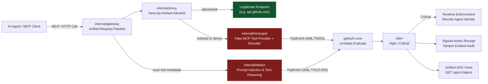

<div align="center">

# GÖKKALKAN

**Agentic AI Runtime Security — MCP Egress Proxy & Agent Honeypot Deception (Göktürk Platform P2)**

[](https://go.dev/)
[](https://www.postgresql.org/)
[](docs/THREAT_MODEL.md)
[](docs/THREAT_MODEL.md)
[](PROJECT_PLAN.md)
[](https://github.com/GokturkFK)

*Block prompt-injected or tool-poisoned AI agents from reaching unauthorized endpoints at runtime, emit Critical SOC alerts + cryptographically signed action receipts, and let legitimate tool calls pass unobstructed.*

</div>

---

## Demo


*Recorded against a live `docker compose` stack (PostgreSQL + `gokkalkan`) following [`docs/demo-script.md`](docs/demo-script.md). Legitimate calls reach `api.github.com` and return `200 OK`; poisoned/unauthorized calls are intercepted and produce a Critical alert with a signed action receipt.*

---

## Overview

**GÖKKALKAN** is Pillar 2 (P2) of the Göktürk Security Platform, protecting **Model Context Protocol (MCP)** and autonomous AI agent runtimes against tool poisoning, prompt injection, and unauthorized egress.

It imports [`gokturk-core`](https://github.com/GokturkFK/gokturk-core) directly—reusing the exact same `trap.Provider`/`TripEvent` wire contract and zero-FP `correlate.Evaluate` engine as [`gokturk-deception-mesh`](https://github.com/GokturkFK/gokturk-deception-mesh) and [`gokzincir`](https://github.com/GokturkFK/gokzincir).

- Threat model & NSA MCP / OWASP Agentic Top 10 mapping: [`docs/THREAT_MODEL.md`](docs/THREAT_MODEL.md)
- Architectural decisions: [`docs/DECISIONS.md`](docs/DECISIONS.md)
- Project plan: [`PROJECT_PLAN.md`](PROJECT_PLAN.md)

---

## Architecture



### Core Packages

| Package | Responsibility | Contract |
| :--- | :--- | :--- |
| **`internal/gateway`** | Single request pipeline unifying proxy, detection, honeypot, correlation, enforcement, and receipts | End-to-end HTTP/MCP gateway |
| **`internal/proxy`** | Deny-by-default egress allowlist enforcement (host, method, path-prefix) | Pure evaluator backed by `Store` interface |
| **`internal/honeypot`** | Decoy MCP tool provisioning and invocation detection (`AML.T0053`) | `gokturk-core/trap.Provider`, `trap.Decoder` |
| **`internal/detect`** | Tool-description scanning for prompt injection & tool poisoning (`AML.T0110.000`) | `gokturk-core/trap.Decoder` |

---

## Getting Started

### Prerequisites

- **Go 1.25+**
- **Docker** & **Docker Compose v2+**

### Run the Stack

```sh
cp deployments/docker/.env.example deployments/docker/.env
make docker-up
```

### Development, Testing & Migrations

```sh
make build
make test
make lint

# Database migrations
make migrate-up
make migrate-down
```

### Branch & PR Rules

Same as `gokturk-deception-mesh`: `main` is protected, PR + CI required, squash-only merges, force-push and branch deletion disabled. Work is tracked as [issues](../../issues) — `cyber` = [@fetihcakmak](https://github.com/fetihcakmak) (security core), `devops` = [@uzunkubra50](https://github.com/uzunkubra50) (platform/delivery/wiring). File ownership: [`CODEOWNERS`](CODEOWNERS).

---

## Göktürk Security Platform

| Pillar | Repository | Focus |
| :---: | :--- | :--- |
| **Core** | [**`gokturk-core`**](https://github.com/GokturkFK/gokturk-core) | Frozen `trap` wire contract & deterministic `correlate` engine |
| **P1** | [**`gokturk-deception-mesh`**](https://github.com/GokturkFK/gokturk-deception-mesh) | Credential canaries, SSH sensor, NATS JetStream & unified SOC dashboard |
| **P2** | **`gokkalkan`** *(this repo)* | Agentic AI runtime security — MCP egress proxy & agent honeypot |
| **P3** | [**`gokzincir`**](https://github.com/GokturkFK/gokzincir) | Non-Human Identity (NHI) governance & blast-radius graph |

---

<div align="center">
  <sub>Developed by <a href="https://github.com/GokturkFK">GokturkFK</a> · Security Kernel: <a href="https://github.com/fetihcakmak">@fetihcakmak</a> · Platform/DevOps: <a href="https://github.com/uzunkubra50">@uzunkubra50</a></sub>
</div>
